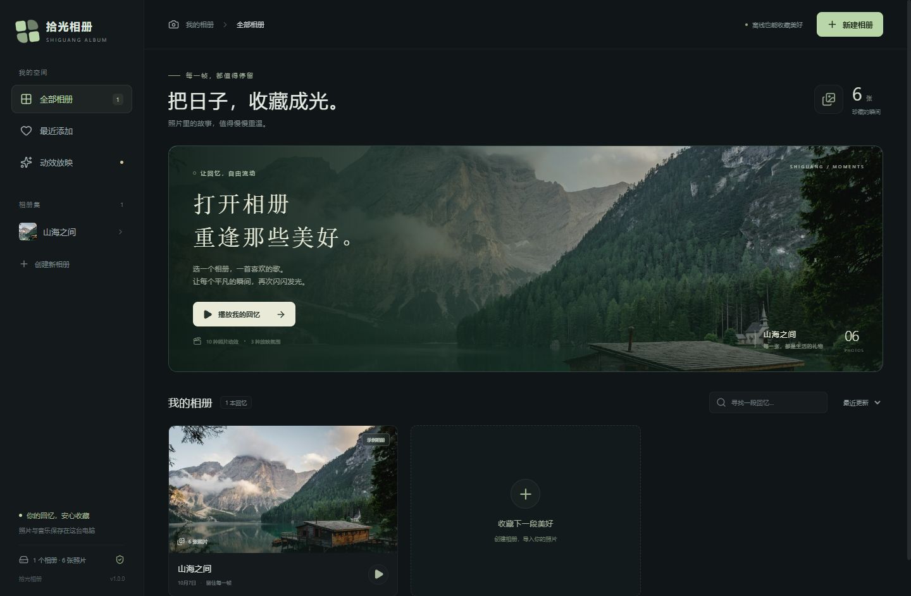

# 拾光相册

一款给照片配上音乐、自动放映回忆的 Windows 离线电子相册。中文界面，支持多个相册、十种动效和三种放映氛围。



## 下载和打开

适用于 Windows 10 / 11，64 位。

- **便携版**：`Shiguang-Album-1.0.0-x64-portable.exe`，双击即可打开，不需要安装 Node.js 或其他运行环境。
- **安装版**：`Shiguang-Album-1.0.0-x64-nsis.exe`，可选择安装位置，创建桌面和开始菜单快捷方式。
- **源码包**：`Shiguang-Album-1.0.0-source.zip`。

本次先交付本机文件，位于项目的 `release` 文件夹，GitHub 发布暂缓。首版程序未签名，可对照随附的 `SHA256SUMS.txt` 核对文件。程序不含自动更新。

## 开始收藏回忆

1. 第一次打开会出现“山海之间”示例相册，可以直接播放。
2. 点右上角“新建相册”，输入名称。
3. 进入相册，点“导入照片”批量选择图片，或“导入文件夹”递归读取照片。也可以把照片或文件夹拖进窗口。
4. 拖动照片调整顺序。选中照片后，可以设置封面或批量移除；每张照片也有前移、后移按钮。
5. 在右侧选一种放映氛围和动效，设置停留时间，加入一首背景音乐。
6. 点“开始放映”。播放器底部可以暂停、切换动效、随机播放、调节声音和进入全屏。

**快捷键**：空格暂停 / 继续；左右方向键切换照片；`F` 切换全屏；`Esc` 退出全屏，再按一次返回相册。

关闭后会保存相册、照片顺序、封面、背景音乐和播放设置；重新打开回到相册首页。

## 支持的格式与效果

| 类型 | 支持内容 |
| --- | --- |
| 照片 | JPG / JPEG、PNG、WebP、GIF、BMP、AVIF、HEIC / HEIF |
| 背景音乐 | MP3、WAV、OGG、M4A；每个相册一首，循环播放 |
| 动效 | 淡化、横向滑动、纵向滑动、缩放、慢推拉、立体翻页、立方体旋转、横向百叶、纵向百叶、棋盘格显现 |
| 氛围 | 温馨时光、电影记忆、闪耀瞬间 |
| 播放 | 顺序或随机、循环、暂停、前后切换、全屏 |
| 照片显示 | 默认完整显示，可改为铺满画面 |

默认每张停留 5 秒，可以调整为 3–30 秒，普通转场约 700 毫秒。选择“主题内随机”时，动效不会连续重复。系统启用“减少动态效果”后，转场改为柔和淡化。

HEIC 在后台转为播放用 JPEG，同时保留库中的原始文件；转换所需组件随程序附带，断网也可以导入。缩略图按照片的方向显示。GIF 保留原始动画。损坏或无法转换的照片会单独提示，成功导入的照片仍然保留。

M4A 是容器格式，内部编码不被支持或受保护的音乐可能无法播放，程序会提示更换文件。HEIC 的播放用 JPEG 是普通色彩范围的预览，不提供 HDR 或 Live Photo 视频播放；原件不会被替换。

单张照片最大 200 MB、1 亿像素；单次最多导入 20000 张。重复照片按文件内容识别，当前相册内自动跳过，允许不同相册各自收藏同一张照片。

## 数据保存与备份

照片和音乐会**复制**到本机相册库。导入后移动或删除原文件不会影响已经导入的照片；在相册里移除照片只处理相册库副本。

数据目录：`%APPDATA%\ShiguangPhotoAlbum\library`。便携版和安装版共用这个本机数据目录，便携程序移动到其他文件夹不会移动照片库。

需要备份或换电脑时，先关闭程序，再复制整个 `library` 文件夹到安全的位置。在另一台电脑上首次运行后关闭程序，用备份替换其 `library` 文件夹，再打开即可。

相册索引采用带版本号的 JSON，保存时写入临时文件后原子替换，并保留上一份备份。读取损坏的索引时尝试从备份恢复并给出提示；两份索引都无法读取时会停止打开，避免覆盖原数据。卸载程序会保留相册数据。

程序不上传照片或音乐，不含云同步、登录、遥测或在线播放功能。仓库、源码包及安装包只包含程序和六张公开授权的示例照片。

## 从源码构建

需要 Windows x64、Node.js 24 LTS 和 npm。依赖及间接依赖版本由 `package-lock.json` 锁定。

```powershell
npm ci
npm run build
npm test
npm run test:desktop
npm run dist
npm run checksums
```

生成文件位于 `release`。Electron 的首次依赖安装和打包工具下载需要联网；生成的程序可离线运行。

开发预览：先运行 `npm run dev`，再在另一个终端执行 `npx electron . --dev`。也可以打开 `http://127.0.0.1:5173` 查看浏览器预览；浏览器使用独立的临时预览库，完整 HEIC 和文件夹导入功能请用桌面版。

## 验证

- `npm test`：相册隔离、排序、封面、重复导入、损坏文件、取消、磁盘不足、写入失败、备份恢复和随机顺序。
- `npm run test:desktop`：真实 Electron 程序的本地图片、音乐、转场、暂停恢复及快速切换。测试数据保存到忽略的 `.test-data`，与个人相册隔离。
- `npm run test:soak`：500 张 JPG / PNG 混合照片持续播放 30 分钟，记录转场、图层、缓存、计时器和内存。
- 可通过 `node scripts/test-desktop.mjs --exe="程序的绝对路径"` 对打包后的程序运行同样的测试。

可选图片测试样例放到 `.test-data/heic-fixtures` 和 `.test-data/format-fixtures`。`scripts/generate-test-media.py` 使用 Pillow 生成竖图、旋转、动态 GIF 和损坏 HEIC 等合成样例；这些文件不会发布。具体发行验证见 [验收记录](docs/QA.md)。

## 许可

拾光相册源码采用 [MIT](LICENSE)。第三方组件保留各自许可，详见 [第三方许可说明](resources/THIRD-PARTY-NOTICES.md)。HEIC 解码组件的 LGPL 源码、构建说明和许可随发行附带，允许替换和调试这些组件。

示例照片来自 Unsplash，来源及许可见 [照片说明](resources/demo/CREDITS.md)。
